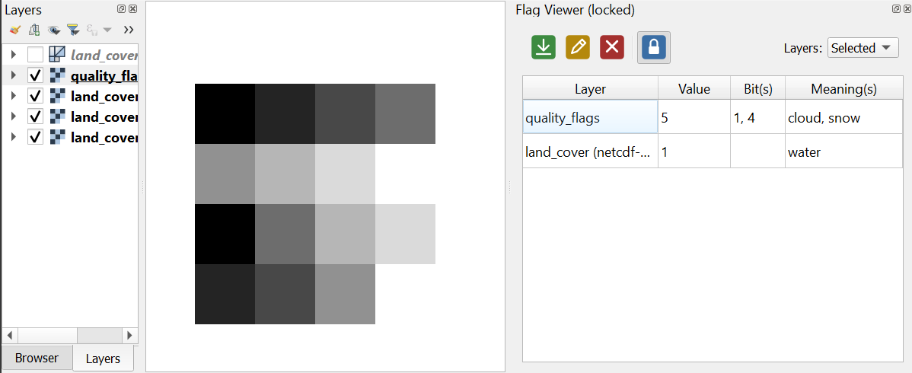

# Flag Viewer (QGIS plugin)

A QGIS plugin that samples the raster band value under the mouse cursor,
like [Value Tool](https://github.com/jorgealmerio/valuetool), but decodes
it into its [CF `flag_meanings`](https://cfconventions.org/cf-conventions/cf-conventions.html#flags)
in addition of showing the raw digital number. This is particularly handy
for bitmask flags, where a single value can have several flags active at
once (e.g. `5` = cloud + snow) that are otherwise tedious to decode by
hand.

## Supported flag mapping sources

A mapping turns a raw band value into one or more meanings:

- **Auto-detection**
  - Reads the CF `flag_meanings`/`flag_values`/`flag_masks` attributes
    straight from the dataset's own metadata
- **Layer custom property**
  - A mapping saved earlier via Load/Edit, checked before auto-detection
  - Saved in the project file, so it persists across sessions
- **User-supplied mapping**, when nothing above applies
  - **Load Flag Mapping...**: load a JSON/YAML file
  - **Edit Flag Mapping...**: build one by hand in a GUI table editor,
    optionally saving it to a file
  - Both save the result onto the layer automatically
  - **Clear Flag Mapping** removes it again

Two flag styles are supported:
- **Categorized**: one value, one meaning (e.g. `2` = forest)
- **Bitmask**: each bit is its own meaning, so several can apply at once
  (e.g. `5` = cloud + snow)

## Plugin functionality

Toggling the Flag Viewer icon on QGIS's Plugins toolbar turns
hover-sampling on or off and shows/hides the dock widget. The dock
widget's own toolbar has icons for:

| Command | What it does |
|---|---|
| Load Flag Mapping... | Loads a JSON/YAML mapping file for the active raster layer. |
| Edit Flag Mapping... | Opens the GUI table editor to build or modify a mapping for the active raster layer by hand. |
| Clear Flag Mapping | Removes the mapping for the active raster layer. |
| Lock | Click a spot on the map to freeze the table on that position instead of updating live, so you can inspect or copy values without holding the mouse in place. Right-click, Escape, or the toggle again to resume. |

Load/Edit/Clear all act on the currently selected raster layer.

A **Layers** dropdown in the dock widget's toolbar controls which layers
are sampled under the cursor (remembered across QGIS sessions):
- **All**: every layer in the project (default)
- **Visible**: layers currently checked on in the Layers panel
- **Selected**: layers currently highlighted in the Layers panel
